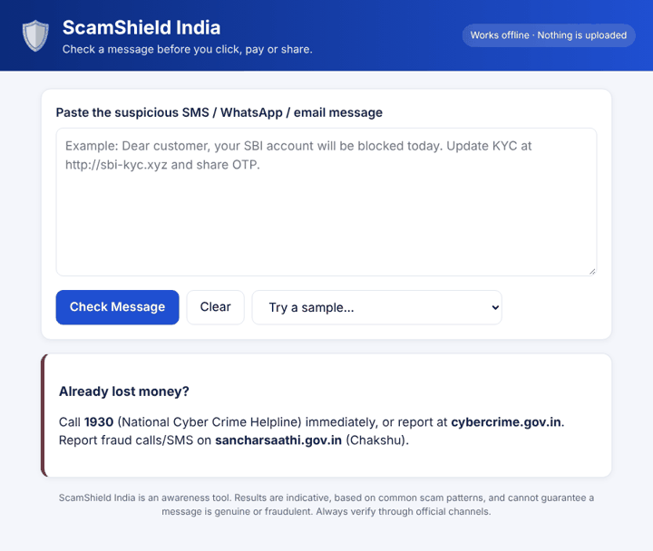
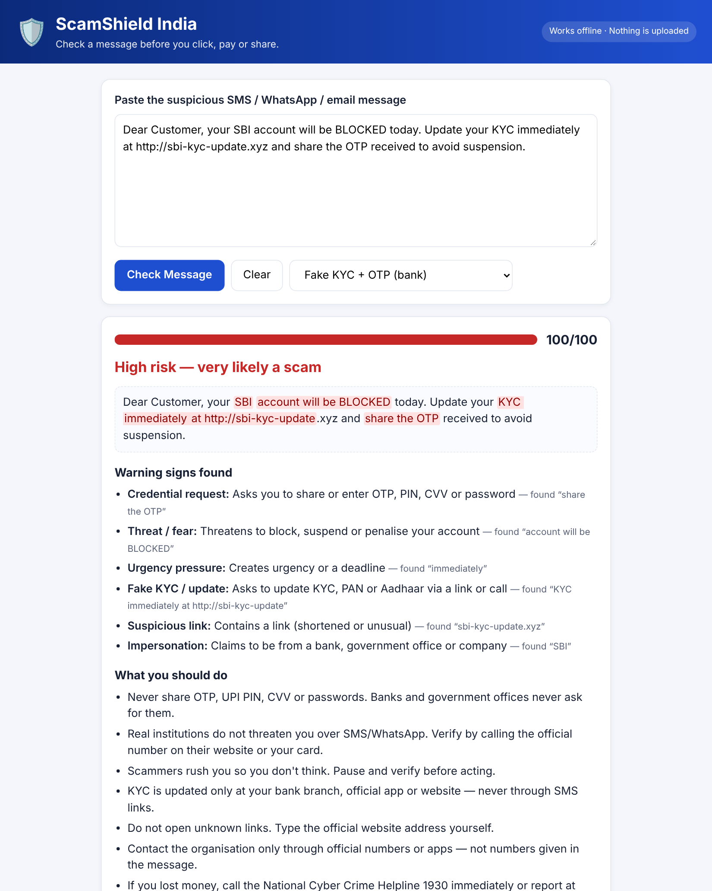
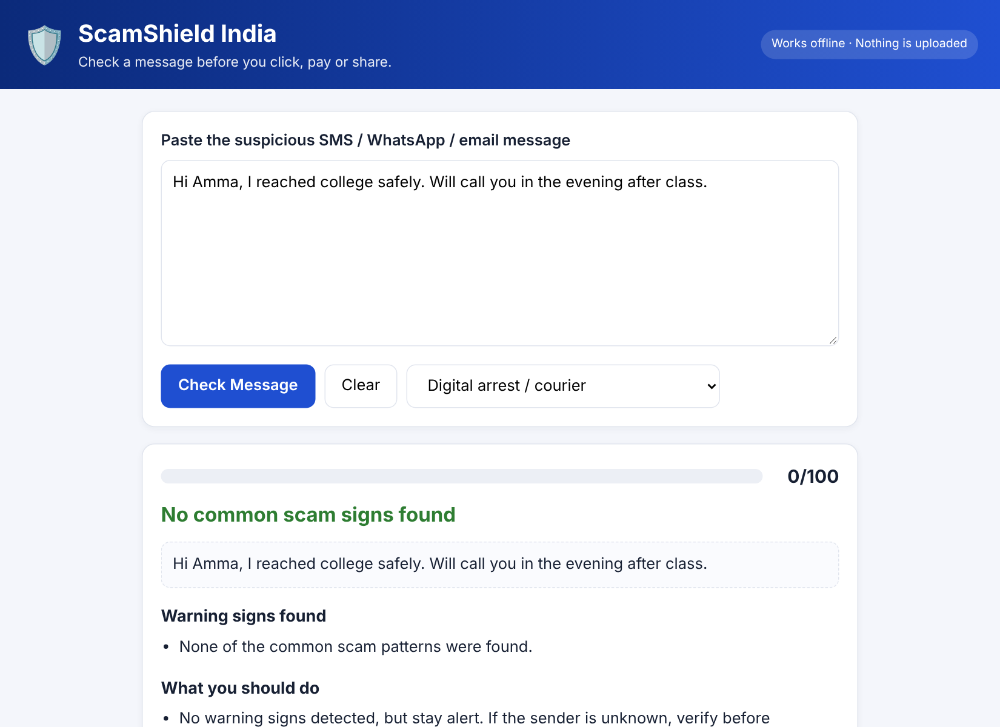
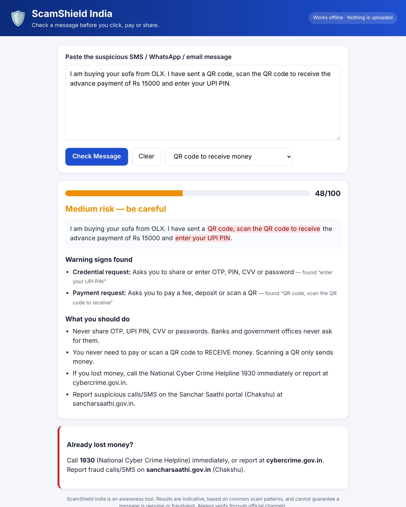
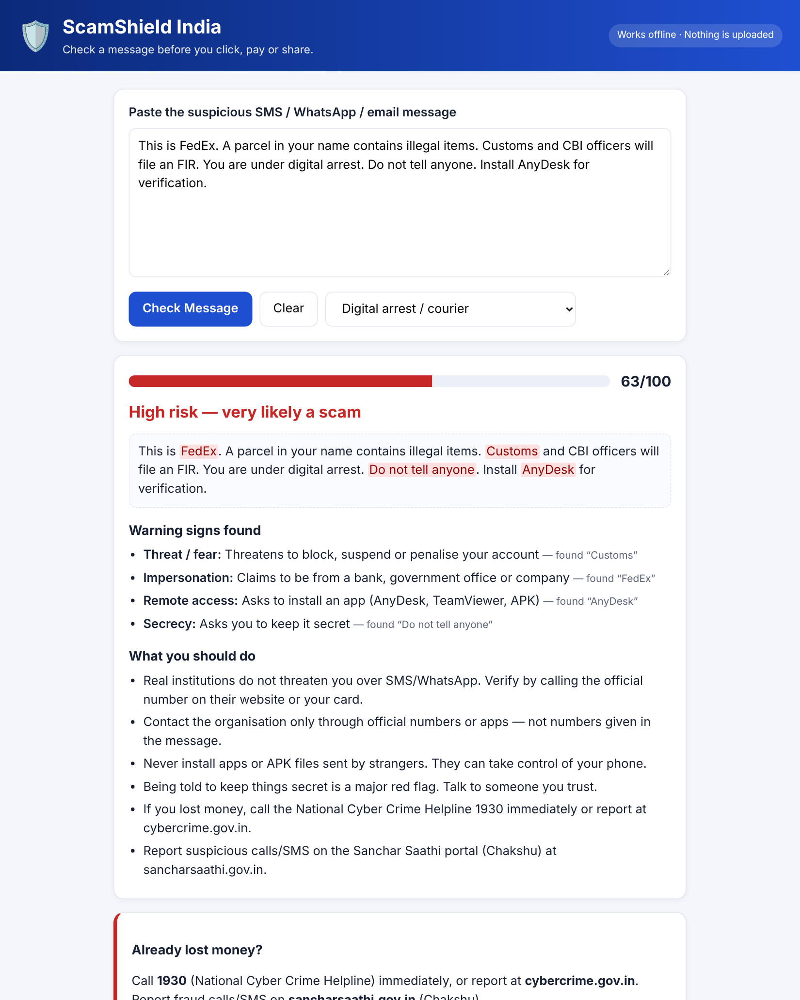
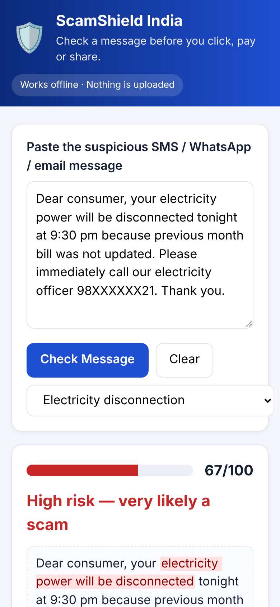
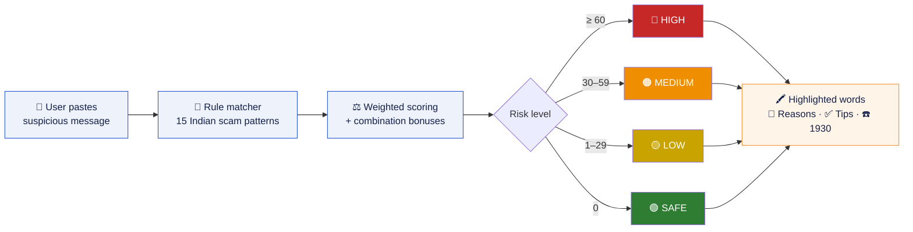
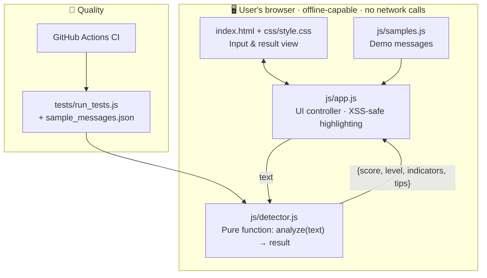

<p align="center">
  
</p>

<p align="center">
  <a href="https://vishnur2810.github.io/scamshield-india/"></a>
  <a href="#-running-the-tests"></a>
  <a href="LICENSE"></a>
</p>

<p align="center">
  
  
  
  
  
  
  
</p>

<p align="center">
  <b>Hack for Social Cause · VBYLD 2027</b> &nbsp;|&nbsp; Theme: <b>Digital Safety &amp; Cyber Fraud Awareness</b> &nbsp;|&nbsp; Team from <b>Tamil Nadu</b>
</p>

---

## 📌 Table of contents
- [The problem](#-the-problem)
- [Our solution](#-our-solution)
- [Demo](#-demo)
- [Features](#-features)
- [How it works](#%EF%B8%8F-how-it-works)
- [Quick start](#-quick-start)
- [Running the tests](#-running-the-tests)
- [Project structure](#-project-structure)
- [Social impact & UN SDGs](#-social-impact--un-sdgs)
- [Roadmap](#%EF%B8%8F-roadmap)
- [Limitations](#%EF%B8%8F-limitations)
- [Team](#-team) · [AI disclosure](#-disclosure-of-ai-tool-usage) · [License](#-license)

---

## 🚨 The problem

India's digital payment boom has brought a wave of cyber fraud that arrives as ordinary-looking SMS and WhatsApp messages:

| Scam type | What the message says |
|---|---|
| 🏦 Fake KYC | *"Your bank account will be blocked today, update KYC at this link"* |
| 🔐 OTP theft | *"Share the OTP you received to verify your account"* |
| ⚡ Utility threat | *"Your electricity will be disconnected tonight, call our officer"* |
| 🎁 Prize / lottery | *"You won ₹25 lakh! Pay a processing fee to claim"* |
| 📷 QR trick | *"Scan this QR code to receive your payment"* |
| 💼 Task job | *"Earn ₹3000 daily by liking YouTube videos"* |
| 🚔 Digital arrest | *"Your parcel has illegal items, CBI will arrest you, install AnyDesk"* |

**Who gets hurt most:** first-time UPI users, senior citizens, students, job seekers, rural and low-literacy users.

**The gap:** there is no simple, instant, private way to check a message *before* acting. Awareness campaigns are generic, and reporting to **1930** happens only *after* the money is gone.

## 💡 Our solution

**ScamShield India** is a free web app: paste any suspicious message and get, in under a second,

> 🎯 a **risk score (0–100)** · 🖍️ the **red-flag words highlighted** · 📝 **plain-language reasons** · ✅ **what to do next** · ☎️ **official help (1930)**

It runs **entirely in the browser** — no server, no login, no AI API, nothing uploaded — so it is private by design and **works offline**.

## 🎬 Demo

<p align="center">
  
</p>

| 🔴 Fake KYC + OTP → **High risk** | 🟢 Normal family message → **Safe** |
|:---:|:---:|
|  |  |
| 🟠 **QR code "to receive money"** | 🔴 **"Digital arrest" + AnyDesk** |
|  |  |

<p align="center">
  <br>
  <sub>📱 Mobile-first: large text, one-thumb use</sub>
</p>

## ✨ Features

| | Feature | Why it matters |
|---|---|---|
| 🎯 | **Risk score 0–100** with SAFE / LOW / MEDIUM / HIGH levels | One glance tells the user how worried to be |
| 🖍️ | **Highlights the exact suspicious words** | Users *learn* what scams look like |
| 🇮🇳 | **15 rules tuned for Indian scams** — UPI PIN, KYC, Aadhaar/PAN, electricity board, digital arrest, task jobs | Generic spam filters miss these |
| 🧠 | **Combination scoring** (e.g. OTP request + threat) | Mirrors how real scams stack pressure tactics |
| 🛟 | **Actionable tips + official channels** (1930, cybercrime.gov.in, Sanchar Saathi) | Turns a warning into a safe next step |
| 🔒 | **Zero data leaves the device** | Safe to paste private messages |
| 📶 | **Works offline**, no install, no login, ₹0 | Reaches users with poor connectivity |
| ♿ | **Accessible**: high contrast, large fonts, keyboard + screen-reader friendly (`aria-live`) | Built for elderly and first-time users |
| 🧪 | **Automated tests** with labelled real-world samples, run on every push via GitHub Actions | Proves it works, prevents regressions |

## ⚙️ How it works



### Architecture — everything stays in the browser



### Scoring at a glance

| Signal | Weight | | Signal | Weight |
|---|:---:|---|---|:---:|
| 🔐 Asks to share OTP / PIN / CVV | **30** | | 🔗 Shortened / odd link | 15 |
| 🖥️ Remote-access app (AnyDesk, APK) | **25** | | 🎁 Prize / lottery / cashback | 15 |
| ⚡ Utility disconnection threat | **25** | | 💼 Job / "guaranteed returns" | 15 |
| 🚫 Account block / FIR / arrest threat | 20 | | 📞 Call a personal number | 15 |
| 🪪 Fake KYC / PAN / Aadhaar update | 18 | | ⏰ Urgency / deadline | 12 |
| 💸 Fee, deposit or QR request | 18 | | 🤫 "Don't tell anyone" | 10 |

Plus combination bonuses (+10 to +15) for classic pairs like *OTP + threat* or *prize + fee*. Full rule catalogue: **[docs/SCAM_PATTERNS.md](docs/SCAM_PATTERNS.md)** · full design: **[docs/TECHNICAL_DESIGN.md](docs/TECHNICAL_DESIGN.md)**.

## 🚀 Quick start

**Option 1 — Use it online:** 👉 **https://vishnur2810.github.io/scamshield-india/**

**Option 2 — Run locally (no installation):**
```bash
git clone https://github.com/Vishnur2810/scamshield-india.git
cd scamshield-india
# Just open index.html in any browser — that's it.
```

**Option 3 — Local web server:**
```bash
python3 -m http.server 8000      # then open http://localhost:8000
```

> **Environment variables:** none. No API keys, no backend, no configuration.

## 🧪 Running the tests

Requires Node.js 14+ (no `npm install` needed — zero dependencies).
```bash
npm test          # or: node tests/run_tests.js
```

```text
PASS  S01  Fake KYC + OTP (bank)              score=100  level=HIGH
PASS  S02  Electricity disconnection          score= 67  level=HIGH
PASS  S03  Lottery / prize                    score= 63  level=HIGH
PASS  S04  Part-time job / task scam          score= 30  level=MEDIUM
PASS  S05  QR code to receive money           score= 48  level=MEDIUM
PASS  S06  Digital arrest / courier           score= 63  level=HIGH
PASS  S07  Genuine OTP message (no request)   score=  8  level=LOW
PASS  S08  Normal personal message            score=  0  level=SAFE
PASS  S09  Normal meeting reminder            score=  0  level=SAFE
PASS  S10  Investment doubling                score= 45  level=MEDIUM
PASS  E01  Empty input handled

11/11 tests passed
```

✅ 7/7 scam samples flagged · ✅ 3/3 genuine messages **not** falsely alarmed · Tests run automatically on every push ([`.github/workflows/tests.yml`](.github/workflows/tests.yml)).

## 📁 Project structure

```text
scamshield-india/
├── index.html                    # Main web app
├── css/style.css                 # Responsive, accessible styling
├── js/
│   ├── detector.js               # 🧠 Detection engine (browser + Node)
│   ├── app.js                    # UI controller
│   └── samples.js                # Demo messages
├── tests/
│   ├── sample_messages.json      # Labelled test data (scam + genuine)
│   └── run_tests.js              # Zero-dependency test runner
├── docs/
│   ├── TECHNICAL_DESIGN.md       # Architecture & design document
│   ├── SCAM_PATTERNS.md          # Rule catalogue with examples
│   └── USER_GUIDE.md             # Simple guide for end users
├── assets/                       # Banner, demo GIF, screenshots
├── .github/                      # CI workflow + issue templates
├── CONTRIBUTING.md
├── package.json
└── LICENSE                       # MIT
```

## 🌍 Social impact & UN SDGs

| SDG | How ScamShield contributes |
|---|---|
| **16** Peace, Justice & Strong Institutions | Reduces financial crime (16.4); safe access to information (16.10) |
| **9** Industry, Innovation & Infrastructure | Makes digital public infrastructure (UPI, banking) safer to use (9.c) |
| **4** Quality Education | Builds digital & financial literacy through every check (4.4, 4.7) |
| **10** Reduced Inequalities | Free, offline and simple — includes elderly, rural, low-literacy users (10.2) |

**Intended outcomes:** fewer people sharing OTPs or paying fake fees · users who can spot scams on their own · faster reporting to 1930 for those already affected.

## 🗺️ Roadmap

- [x] Rule-based detection engine with 15 Indian scam patterns
- [x] Accessible, offline web prototype + automated tests
- [ ] 🗣️ **Tamil, Hindi** and more Indian languages (rules + UI) and voice read-out
- [ ] 📲 Installable **PWA** and Android "share to ScamShield"
- [ ] 🖼️ Screenshot input with on-device OCR
- [ ] 🤖 On-device ML model for context-aware detection (no data leaves the phone)
- [ ] 👥 Community scam reporting & trending-scam alerts
- [ ] 🏫 Pilots with colleges, NSS volunteers, senior-citizen groups and panchayats in Tamil Nadu

## ⚠️ Limitations

ScamShield India is an **awareness tool**, not an official fraud-detection system. Rule-based detection can miss new scam wording and may occasionally flag a genuine message. Results are **indicative** — always verify through official channels.

## 👥 Team

| Member | Role |
|---|---|
| **Vishnu R** (Team Lead) | Detection engine, testing, submission |
| _[Member 2]_ | UI/UX, accessibility, localisation |
| _[Member 3]_ | Scam research, awareness content, outreach |

## 🤖 Disclosure of AI tool usage

AI assistance (Claude by Anthropic) was used to help draft code, documentation, test messages and visuals. The team defined the problem and concept, chose the scam categories, and reviewed and tested all work. The **product itself uses no AI** — detection is transparent and rule-based.

## 📄 License

Released under the [MIT License](LICENSE) — free to use, modify and share.

## 🆘 Lost money to a scam?

> ☎️ Call **1930** (National Cyber Crime Helpline) **immediately**
> 🌐 Report at **[cybercrime.gov.in](https://cybercrime.gov.in)**
> 📵 Report fraud calls/SMS at **[sancharsaathi.gov.in](https://sancharsaathi.gov.in)** (Chakshu)

<p align="center"><sub>Made with ❤️ in Tamil Nadu for a safer Digital India · Viksit Bharat 2047</sub></p>
